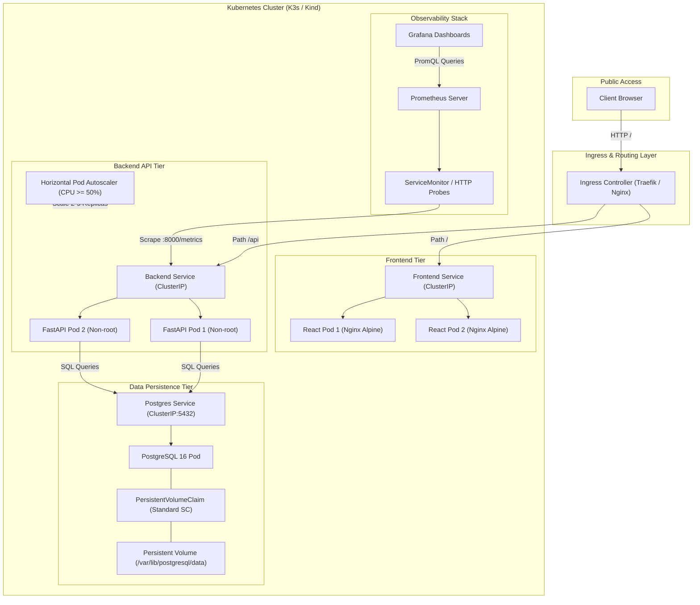
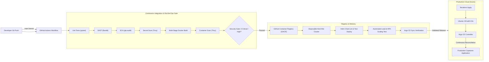

# 🎓 Homework Tracker — Cloud-Native DevOps Capstone Project

<p align="center">
  
  
  
  
  
  
  
  
</p>

---

## 📌 Executive Summary

**Homework Tracker** is an enterprise-grade, cloud-native DevOps capstone application designed to track, schedule, and grade course assignments with real-time status progression. Built from the ground up to showcase full-lifecycle DevOps engineering, the project demonstrates:

* **Microservices Architecture**: React 18 + Vite frontend, Python FastAPI REST backend, and PostgreSQL 16 relational database with Alembic schema versioning.
* **Modern Containerization**: Secure multi-stage, non-root Docker builds yielding minimal attack surface and lightweight runtime footprints.
* **End-to-End DevSecOps Pipeline**: Automated testing, static application security testing (Bandit), software composition analysis (pip-audit), secret detection, container image scanning (Trivy), and automated release gating via GitHub Actions.
* **Production Packaging with Helm 3**: Fully parameterized Kubernetes charts supporting configurable replicas, dynamic storage provisioning, Horizontal Pod Autoscaling (HPA), and lifecycle probes (startup, readiness, liveness).
* **GitOps Continuous Reconciliation**: Declarative application state management using Argo CD with automated self-healing and zero configuration drift.
* **Infrastructure as Code (IaC)**: Automated cloud infrastructure provisioning on Microsoft Azure via Terraform with isolated virtual networks, network security groups, and automated bootstrap via cloud-init.
* **Full-Stack Observability**: Metrics scraping via Prometheus, custom Grafana dashboards, alerting rules, and health endpoints.

---

## 🏛️ System Architecture

### 1. High-Level Runtime Topology


---

### 2. DevSecOps & GitOps Delivery Pipeline


---

## 🛠️ Technology Stack Matrix

| Domain | Technology / Tool | Version | Purpose |
| :--- | :--- | :--- | :--- |
| **Frontend** | React, Vite, Nginx | React 18, Node 22 | Modern responsive SPA dashboard, task status boards |
| **Backend API** | Python, FastAPI, Pydantic | Python 3.12 | Asynchronous RESTful API, input validation, CORS handling |
| **Database** | PostgreSQL, SQLAlchemy, Alembic | Postgres 16 | Relational storage, declarative ORM, migration tracking |
| **Containerization** | Docker Engine, Docker Compose | Compose v2 | Multi-stage caching, non-root execution, container isolation |
| **Kubernetes** | K3s, Kind, Kubernetes API | v1.30+ | Container orchestration, self-healing, Service discovery |
| **Package Manager** | Helm 3 | v3.14+ | Templated manifests, release revisions, rollback management |
| **Continuous Integration** | GitHub Actions | Ubuntu 24.04 | Automated test runners, release packaging, artifact publishing |
| **Security / DevSecOps**| Bandit, pip-audit, Trivy, Gitleaks | Latest | SAST, dependency analysis, secret scan, CVE gating |
| **GitOps** | Argo CD Core | v2.10+ | Declarative Git-as-source-of-truth automated delivery |
| **Infrastructure as Code**| Terraform, AzureRM Provider | v1.8+ | Cloud compute, networking, security rules, and teardown |
| **Observability** | Prometheus, Grafana | Latest | Metrics scraping, latency/error tracking, visual dashboards |

---

## 🚀 Quick Start Guide

### Prerequisites
* **Docker Engine** (v24.0+) with **Docker Compose v2**
* **cURL** and modern web browser

### Option 1: Docker Compose (Recommended for Local Evaluation)
Launch the complete stack (Frontend, Backend, Database) with a single command:

```bash
# 1. Clone repository
git clone https://github.com/Rabari9999/devops-homework-tracker.git
cd devops-homework-tracker

# 2. Start services with auto-build and healthcheck verification
docker compose up -d --build --wait

# 3. Verify container statuses
docker compose ps
```

#### Access Points:
| Service | URL / Port | Credentials / Notes |
| :--- | :--- | :--- |
| **Web Dashboard** | [http://localhost:3000](http://localhost:3000) | Interactive assignment tracking interface |
| **Interactive API Docs**| [http://localhost:8000/docs](http://localhost:8000/docs) | Swagger UI for exploring REST endpoints |
| **Readiness Probe** | [http://localhost:8000/ready](http://localhost:8000/ready) | Verifies backend database connectivity |
| **Liveness Probe** | [http://localhost:8000/health](http://localhost:8000/health) | Container health endpoint |

```bash
# Tear down services (preserving database volume)
docker compose down

# Full cleanup (including database volume)
docker compose down -v
```

---

### Option 2: Kubernetes Deployment with Helm 3

Deploy directly to your local Minikube or Kind cluster:

```bash
# 1. Add required repositories and build local images
helm repo add traefik https://traefik.github.io/charts
helm repo update

# 2. Lint Helm chart
helm lint ./helm/taskboard

# 3. Install or upgrade release in dedicated namespace
helm upgrade --install homework ./helm/taskboard \
  --namespace production \
  --create-namespace \
  --values ./helm/taskboard/values-prod.yaml \
  --wait --timeout 300s

# 4. Verify Pods, Services, PVCs, and HPA
kubectl -n production get all,pvc,hpa
```

---

## 📡 RESTful API Reference

The backend provides complete CRUD capabilities for course assignments. Complete interactive schema docs are available at `/docs`.

| Method | Endpoint | Description | Request Body / Query | Status Code |
| :--- | :--- | :--- | :--- | :--- |
| `GET` | `/api/tasks` | List all tasks / assignments | `?session=X&priority=HIGH` | `200 OK` |
| `POST` | `/api/tasks` | Create a new task | JSON task payload | `201 Created` |
| `GET` | `/api/tasks/{id}` | Retrieve specific task details | None | `200 OK` / `404` |
| `PUT` | `/api/tasks/{id}` | Update task status or metadata | JSON update payload | `200 OK` / `404` |
| `DELETE`| `/api/tasks/{id}` | Remove a task | None | `204 No Content` |
| `GET` | `/ready` | Database readiness check | None | `200 OK` / `503` |
| `GET` | `/health` | Application liveness probe | None | `200 OK` |
| `GET` | `/metrics` | Prometheus metrics endpoint | None | `200 OK` |

#### Sample Task Creation Request:
```bash
curl -X POST http://localhost:8000/api/tasks \
  -H "Content-Type: application/json" \
  -d '{
    "title": "Session 21 Capstone Deployment",
    "description": "Complete production verification on K8s",
    "session": "Session 21",
    "assignee": "Krish",
    "priority": "HIGH",
    "status": "IN_PROGRESS",
    "due_date": "2026-10-16"
  }'
```

---

## 🔒 DevSecOps & Security Governance

Security is shifted strictly left with zero tolerance for high or critical vulnerabilities before artifact generation:

| Security Domain | Scanning Tool | Policy / Threshold | Action on Failure |
| :--- | :--- | :--- | :--- |
| **SAST** | Bandit | Severity: Medium/High | Fails CI pipeline |
| **SCA** | pip-audit & npm audit | CVSS >= 7.0 (High/Critical) | Fails CI pipeline |
| **Secret Scanning** | Trivy (FS Secret Scanner) | Any detected API key / token | Fails CI pipeline |
| **Container Images** | Trivy Container Scanner | Severity: HIGH,CRITICAL | Blocks GHCR publishing |
| **Container Runtime** | Non-Root User Execution | UID 10001 (backend) / non-root (frontend) | Enforced in Dockerfiles |

---

## 📈 Observability & Autoscaling (HPA)

### 1. Prometheus Telemetry
The application exposes Prometheus-compliant metrics and supports automated scraping:
* CPU and Memory utilization per container.
* HTTP request rates, response latency percentiles ($p50$, $p95$, $p99$), and HTTP error codes.
* Active database connection pool metrics.

### 2. Horizontal Pod Autoscaling (HPA)
The backend includes an active `HorizontalPodAutoscaler` resource:
* **Metric**: Average CPU utilization $\ge 50\%$.
* **Replica Bounds**: Minimum 2 Pods, Maximum 5 Pods.
* **Scale-down Stabilization**: 30-second window to prevent thrashing.
* **Load Test Validation**: Verified using custom ApacheBench / HTTP load scripts in `scripts/load-test.sh`.

---

## ☁️ Cloud Infrastructure as Code (Terraform)

Located in [`terraform/`](terraform/):
* **Provider**: `hashicorp/azurerm`
* **Provisioned Resources**:
  * Azure Resource Group (`rg-homework-tracker`)
  * Virtual Network (`10.21.0.0/16`) & Subnet (`10.21.1.0/24`)
  * Network Security Group with strict port 80/443 ingress and restricted SSH admin access
  * Ubuntu 24.04 LTS Compute Instance running lightweight K3s Kubernetes
* **Automated Cloud-Init**: Installs K3s, Helm, Prometheus, and Traefik Ingress automatically upon boot.
* **Full Teardown**: Cleanly destroyed with `terraform destroy -auto-approve`.

---

## 📂 Repository Directory Layout

```text
├── .github/
│   └── workflows/ci-cd.yml      # Automated CI/CD + DevSecOps Pipeline
├── backend/
│   ├── alembic/                 # Database migrations (PostgreSQL schemas)
│   ├── app/                     # FastAPI core, database ORM, routers, schemas
│   ├── tests/                   # Pytest test suite (11 unit and API tests)
│   └── Dockerfile               # Multi-stage non-root Python build
├── frontend/
│   ├── src/                     # React 18 dashboard, CSS styling, components
│   ├── nginx.conf               # Hardened reverse-proxy Nginx config
│   └── Dockerfile               # Multi-stage build (Node -> Nginx Alpine)
├── helm/
│   └── taskboard/               # Production Helm 3 chart (Templates, Values)
├── gitops/                      # Declarative Argo CD Application manifests
├── k8s/                         # Standalone Kubernetes manifests (Namespaces, RBAC)
├── monitoring/                  # Prometheus and Grafana values and alert configs
├── terraform/                   # Azure Infrastructure as Code configurations
├── scripts/                     # Load testing, verification, and diagnostics scripts
├── docs/                        # In-depth architectural and deployment runbooks
└── screenshots/                 # Captured terminal outputs and execution evidence
```

---

## 📜 Documentation Links

* [**Deployment Guide**](docs/deployment.md): Detailed production Kubernetes and Cloud VM setup.
* [**Local Development Guide**](docs/development.md): Environment variables, database setup, and testing.
* [**Verification Matrix**](docs/verification.md): Complete rubric checklist and test output artifacts.
* [**Troubleshooting Runbook**](docs/troubleshooting.md): Diagnosis workflows for common Kubernetes failure scenarios.
* [**Submission Details**](docs/course/submission.md): Course requirements and delivery verification.

---

## 👤 Author & Maintainer

* **Author**: Krish Rabari
* **GitHub**: [@Rabari9999](https://github.com/Rabari9999)
* **Email**: [rabarikrishramjibhai2905@gmail.com](mailto:rabarikrishramjibhai2905@gmail.com)
* **Course**: DevOps Heroes Advanced Curriculum
